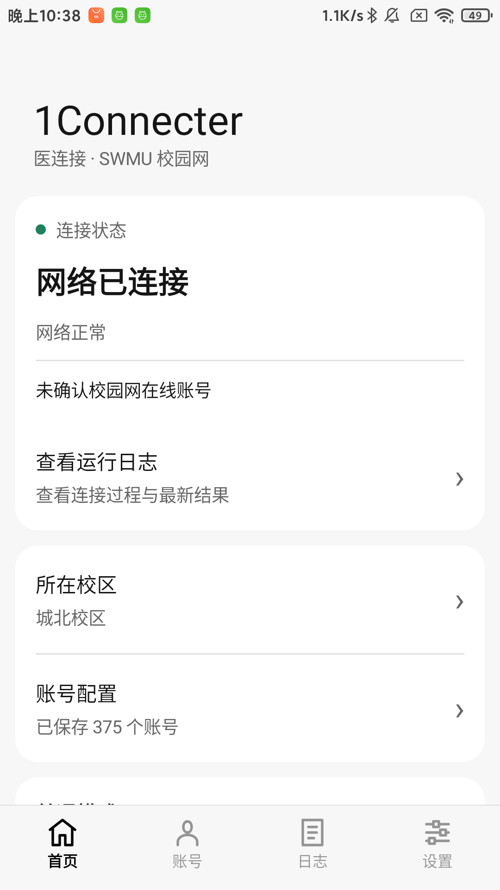
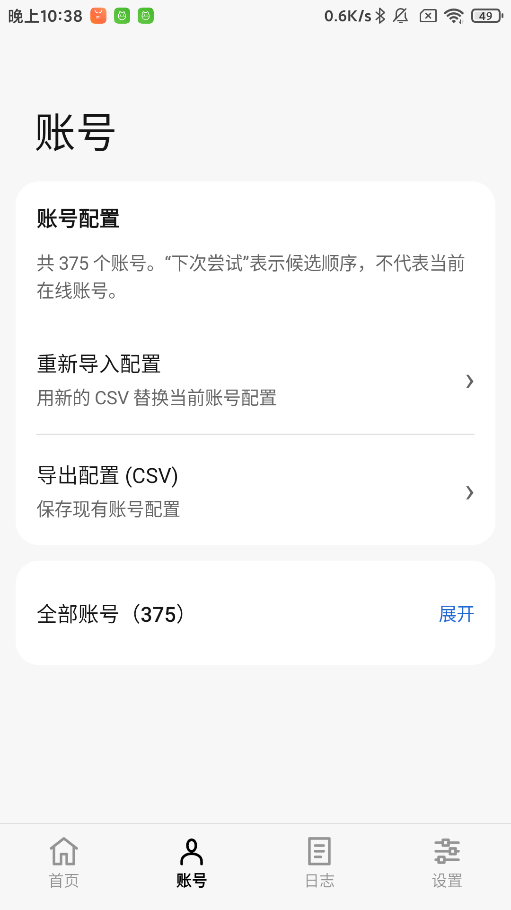
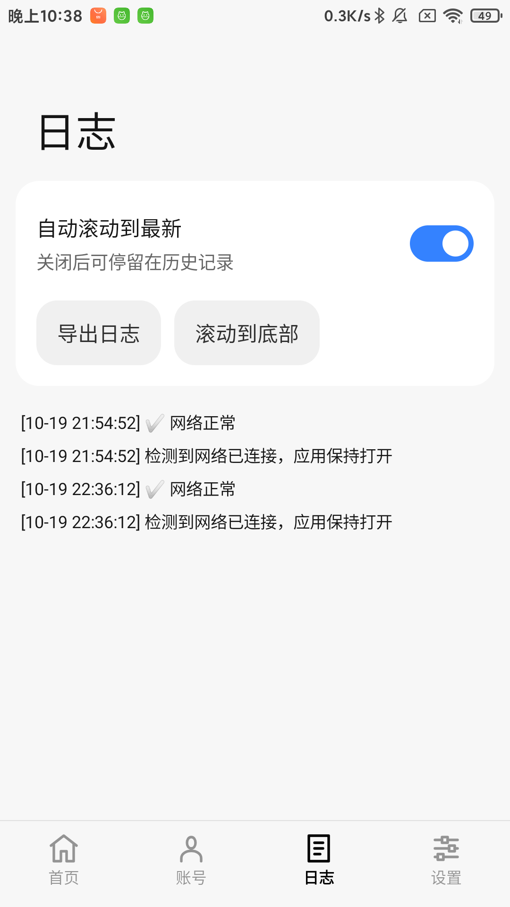
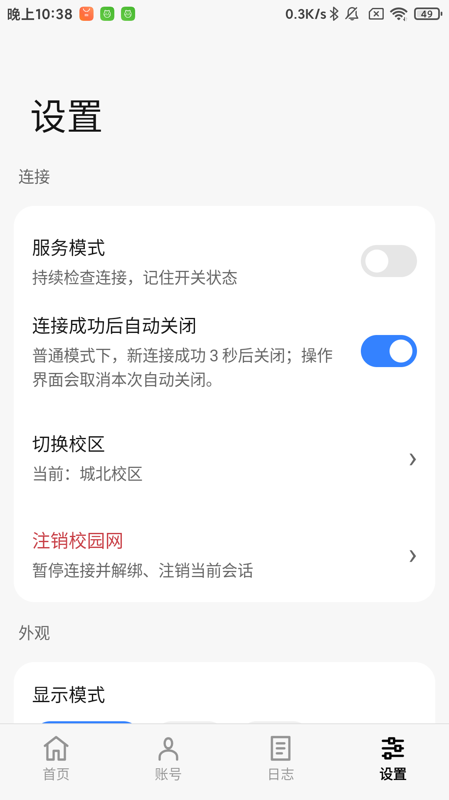

<a id="readme-top"></a>

<div align="center">
  
  <h1>1Connecter</h1>
  <p>面向 SWMU 校园网的 Android 自动登录与断线恢复工具</p>
  <p>
    <a href="https://github.com/oneringr/1Connecter/releases/latest">下载最新版</a>
    ·
    <a href="#usage">使用说明</a>
    ·
    <a href="https://github.com/oneringr/1Connecter/issues/new">反馈问题 / 提出建议</a>
  </p>
</div>

<details>
  <summary>目录</summary>
  <ol>
    <li><a href="#about">关于项目</a></li>
    <li><a href="#getting-started">开始使用</a></li>
    <li><a href="#usage">使用说明</a></li>
    <li><a href="#roadmap">路线图</a></li>
    <li><a href="#contributing">参与贡献</a></li>
    <li><a href="#license">许可证</a></li>
    <li><a href="#contact">联系与反馈</a></li>
    <li><a href="#acknowledgments">致谢</a></li>
  </ol>
</details>

<a id="about"></a>

## 关于项目

1Connecter 通过 Dr.COM 接口连接校园网，支持 CSV 多账号管理、运营商选择、前台服务保活和运行日志导出。应用会先检查外网与校园网会话，再决定是否需要认证，减少重复登录引起的 `clientip online` 冲突。

| 校区 | 登录地址 | 验证情况 |
| --- | --- | --- |
| 城北 | `http://172.17.254.6/drcom/login` | 已进行实机登录与恢复测试 |
| 忠山 | `http://192.168.2.27/drcom/login` | 已实现，待真实校园网验证 |

主要功能：

- 导入、管理和导出多个账号，记住账号上次成功的运营商。
- 支持移动、电信登录及普通认证失败时的账号轮换。
- 保留可正常上网的已有会话；遇到 `clientip online` 且外网不可用时自动清理、等待并重试。
- 通过常驻通知提供持续监测，支持主动注销校园网和导出诊断日志。

### 2.0 更新

- 使用 Miuix 重写扁平化界面，分为首页、账号、日志和设置，支持主题切换与底部导航过渡动画。
- 增加两步首次引导：导入 CSV 后选择校区及自动关闭设置，完成后才启动连接；已有账号的用户升级时保留设置。
- 账号列表支持折叠及姓名、学号搜索；日志布局更紧凑，按钮按压反馈覆盖整个可点击区域。
- 关于页支持项目链接和手动检查 GitHub 正式版本；补充开关名称与选中状态的无障碍信息。
- 将账号、登录偏好和待恢复会话排除在系统云备份与设备迁移之外；更换设备请使用 CSV 导出、导入。

### 界面截图

以下为 2.0 浅色主题的 Android 9 真机截图。账号列表保持折叠，不展示个人账号信息。

| 首页 | 账号 | 日志 | 设置 |
| :---: | :---: | :---: | :---: |
|  |  |  |  |

### 技术栈

Kotlin · Jetpack Compose / Miuix · Kotlin Coroutines · OkHttp · Gson · Apache Commons CSV · Konfetti

Android 配置：`minSdk 26`、`compileSdk 37`、`targetSdk 34`。构建使用 Gradle 9.7.1、Android Gradle Plugin 9.4.1、Kotlin 2.4.20 和 Miuix 0.9.4。界面参考 HuaweiPods 的扁平化设计，使用实色分组卡片和贴底导航，支持浅色、深色与跟随系统，兼容 Android 9。

<a id="getting-started"></a>

## 开始使用

### 前提条件

使用应用需要 Android 8.0（API 26）及以上设备、可访问对应校园网网关的网络，以及有效的校园网账号。

从源码构建另需：

- JDK 17 或与当前 Gradle / AGP 兼容的更高版本。
- Android SDK Platform 37，可用 Android Studio 安装并打开项目。
- 配置 `ANDROID_HOME`，或在本地 `local.properties` 中设置 `sdk.dir`。

项目生成的 Java / Kotlin 字节码目标为 Java 11；运行构建工具仍需要 JDK 17 及以上。

### 安装与构建

直接使用可前往 [Releases](https://github.com/oneringr/1Connecter/releases/latest) 下载 APK 并安装。升级前建议通过应用菜单导出账号配置；只有相同签名的 APK 才能直接覆盖安装。

开发者可克隆项目：

```bash
git clone https://github.com/oneringr/1Connecter.git
cd 1Connecter
```

Windows 构建调试版：

```powershell
.\gradlew.bat assembleDebug
```

macOS / Linux 构建调试版：

```bash
./gradlew assembleDebug
```

APK 位于 `app/build/outputs/apk/debug/app-debug.apk`，也可在 Android Studio 中运行 `app` 模块。发布签名资料由维护者在仓库外管理。

<a id="usage"></a>

## 使用说明

### 界面导航

- **首页**：查看网络状态、服务运行状态和校区，进入账号导入与运行日志。
- **账号**：导入或导出 CSV；展开“全部账号”后浏览列表，按姓名或学号搜索。候选标记表示下一轮使用的位置，不代表当前在线账号。
- **日志**：以紧凑间距查看运行过程，控制自动滚动并导出日志。
- **设置**：调整服务模式、自动关闭、校区和主题，注销校园网；在“关于”中打开项目主页或手动检查新版本。

界面将服务模式开关、实际服务运行和连接暂停分别展示；开关开启不代表当前正在保活或已经联网。

底部导航切页使用短距离滑动与淡入淡出动画，并保留各页滚动位置。账号菜单的展开状态和搜索关键词也会在切页时保留。

### 首次连接

1. 连接校园网络或接入校园网的路由器 Wi-Fi。
2. 首次打开应用，在引导第一步导入账号 CSV；成功导入后点击“下一步”。
3. 第二步选择城北或忠山校区，设置“连接成功后自动关闭”（默认开启），再点击“开始使用”。完成引导后才会检测网络并按需登录。
4. 需要持续监测时，在设置中开启“服务模式”。

引导未完成时退出应用，下次会继续；已导入账号无需重复导入。已有账号的老用户升级后直接进入首页，保留原有设置。

### 项目与更新

打开“设置 → 关于”可跳转项目主页。点击“检查更新”后查询 GitHub 最新正式 Release；有新版本时显示“有新版本，点击跳转 Release”，再次点击打开对应发布页。检查失败可重试，应用不会自动下载或安装更新。

### CSV 账号配置

下载 [CSV 模板](template/template.csv)，按以下表头准备文件；列顺序不限。

| 表头 | 是否必填 | 用途 |
| --- | --- | --- |
| 学号 | 是 | 校园网登录账号 |
| 身份证号 | 是 | 生成登录密码 |
| 姓名 | 否 | 账号显示名称 |
| 班级 | 否 | 保存与导出 |
| 联系电话 | 否 | 保存与导出 |

密码取身份证号字段的后 6 位，并将其中的 `X` 或 `x` 替换为 `0`；非空但不足 6 位时使用 `123456` 并产生导入警告。学号或身份证号为空的记录会被跳过。

推荐 UTF-8 编码，也兼容 UTF-8 BOM、GBK / GB18030、空表头列、引号字段、字段内逗号和多行字段。“导出配置 (CSV)”会保存上述五列并带 UTF-8 BOM，可再次导入。成功导入会替换现有账号列表，并重置轮换位置与运营商记忆。

### 普通模式与服务模式

| 模式 | 行为 |
| --- | --- |
| 普通模式 | 打开应用后检测并尝试连接；“连接成功后自动关闭”默认开启，本次实际登录成功后延迟 3 秒关闭界面。可在设置中关闭；用户操作界面会取消本次自动关闭，启动时已联网也会保持界面打开。 |
| 服务模式 | 使用带常驻通知的前台服务，联网时约每 60 秒检查一次，断线时进入恢复流程；可在通知中“停止保活”。 |

服务模式开关会被记住，重新打开应用时按该设置恢复。账号列表为空时暂停服务，导入有效账号后可继续；主动注销只暂停连接，不清除开关选择。通知中的“停止保活”会关闭服务模式，之后重新打开应用仍可进行普通模式登录。

自动关闭规则与开关已纳入首次引导第二步，不再单独弹窗提示。完成引导属于本次用户操作，当前界面会保持打开；后续启动按保存的自动关闭设置运行。主题选择同样会保存。

Android 13 及以上会请求通知权限，拒绝后前台服务仍可运行，但通知可能仅在系统任务管理器中显示。系统的后台限制可能结束进程；划掉最近任务能否保留服务取决于设备。设备重启或强行停止后，需要重新打开应用。

### `clientip online` 自动恢复

该响应表示网关认为当前客户端 IP 已在线，并不必然意味着外网已经断开。应用按以下顺序处理：

1. 通过百度和腾讯 HTTPS 站点检测外网。任一站点可达时保留现有连接，避免重复登录或误注销。
2. 外网持续不可用时查询校园网会话，优先恢复本地保存的实际在线账号。状态未知或在线账号不在本地时暂停恢复，保留原会话。
3. 使用与手动注销相同的清理流程：具备会话信息时尝试解绑 MAC，再注销，并通过状态接口确认离线。
4. 确认离线后，按 10、20、30、40、50、60 秒递增等待，重试同一账号和运营商；遇到服务端限速时遵守等待时间。
5. 登录成功后再次验证外网。无法确认离线或本轮重试耗尽时，保留账号与轮换位置，至少等待 60 秒后重新检查。待恢复的账号、校区和运营商会独立保存；即使等待期间进程被结束，重新打开应用仍会继续恢复同一账号。

普通认证优先使用账号上次成功的运营商，否则先移动后电信。普通协议错误可轮换运营商和账号；`userid error`、`userid error2`、`bind userid error` 或 `Oppp error` 会移除对应账号。恢复已有会话期间遇到这些错误则保留账号并暂缓重试。

### 主动注销与日志

选择“注销校园网”后，应用先暂停新认证、取消并等待已有任务退出，再执行会话清理。取消任务会同时取消尚未完成的 HTTP 请求。确认离线后可选择“立即重启”恢复连接流程，或“暂不重启”保持暂停；暂停期间重建界面不会重新认证。

运行日志可暂停自动滚动，也可导出到：

```text
/sdcard/Download/connect_logs_yyyyMMdd_HHmmss_SSS.txt
```

Android 8–9 首次导出日志需要存储权限，Android 10 及以上无需该权限。

### 数据存储与适用范围

账号、轮换位置、校区、服务开关和运营商偏好分别保存在应用私有目录的 `accounts.json`、`current_index.txt`、`campus_config.txt`、`keep_alive_config.txt`、`login_preferences.json` 中；`pending_recovery.json` 独立保存尚未完成的恢复会话。账号信息未额外加密；导出的 CSV 和日志也可能包含个人信息。为适配网关，应用对上述两个校区地址使用明文 HTTP。

界面偏好保存在同一私有目录的 `auto_close_config.txt` 和 `theme_mode_config.txt`，首次引导完成状态保存在 `onboarding_completed.txt`。系统备份与设备迁移排除 `accounts.json`、`login_preferences.json` 和 `pending_recovery.json`；账号跨设备转移需手动导出、导入 CSV。

项目依赖当前 Dr.COM 接口与参数，迁移到其他学校通常需要调整代码。两个 HTTPS 探测站点同时不可达时仍可能误判外网状态；忠山校区的 `:801/eportal` 解绑接口按同构路径实现，尚未实测。

应用的 HTTPS 探测和校园网请求使用系统默认网络。如果系统将默认网络切换到蜂窝数据，探测成功可能掩盖校园网断网。本次实机验证使用 Wi-Fi 默认网络，自动化恢复测试还将测试进程绑定到 Wi-Fi；蜂窝数据接管默认网络的场景尚未验证。

城北已验证真实 `clientip online`、注销、离线确认、限速等待和重新登录，以及恢复后的 HTTPS 访问。其中恢复测试注入了前置离线状态与断网判断，网关响应和恢复请求均为真实请求；这不等同于已自然复现并覆盖所有持续断网故障。

<a id="roadmap"></a>

## 路线图

- [x] CSV 账号导入、管理与导出。
- [x] 记忆运营商、前台保活和日志导出。
- [x] 基于会话状态的 `clientip online` 恢复及请求取消。
- [x] Miuix 四页界面、首次引导、账号搜索、主题选择与版本检查。
- [ ] 补充忠山校区真实网络验证。
- [ ] 收集自然持续断网场景，完善恢复回归测试。

具体问题与建议见 [Issues](https://github.com/oneringr/1Connecter/issues)。

<a id="contributing"></a>

## 参与贡献

欢迎通过 Issue 提供复现步骤，或 Fork 仓库后提交 Pull Request。故障报告请注明应用版本、Android 版本、校区、直连校园 Wi-Fi 或路由器接入方式，并附上脱敏日志；不要提交账号 CSV、身份证号、密码、签名文件或未经处理的网络抓包。

修改后可运行单元测试和静态检查：

```powershell
.\gradlew.bat testDebugUnitTest lintDebug
```

界面与生命周期测试位于 `app/src/androidTest`。真实校园网恢复测试需要明确启用 `liveCampus=true`，会执行注销和重新登录；请仅在允许短暂断网、具备有效测试账号的校园网设备上运行。

2.0 发布验证：91 项 JVM 单元测试、18 项 Android 14 模拟器界面与配置测试通过；Debug / Release 构建及 lint 完成，均为 0 错误、31 条警告，主要涉及依赖版本建议、图标及未使用资源。签名 Release 已验证从 1.7 覆盖升级并保留校区、服务设置。Android 9 真机完成首次引导、重启恢复、链接及按压反馈检查，最终 2.0 调试包完成覆盖安装和启动验证；本轮未重跑真实校园网注销与恢复测试。

主要代码入口：

| 路径（位于 `app/src/main/java/top/onering/easyconnecter/`） | 职责 |
| --- | --- |
| `MainActivity.kt`、`MainViewModel.kt`、`ui/` | 界面、权限与用户操作 |
| `domain/ConnectionCoordinator.kt` | 登录轮换、恢复与并发协调 |
| `network/DrcomClient.kt` | Dr.COM 请求与 HTTPS 连通性检测 |
| `service/KeepAliveService.kt` | 前台服务与持续监测 |
| `data/`、`model/` | 本地存储、CSV、日志和数据模型 |

<a id="license"></a>

## 许可证

本项目采用 GNU General Public License v3.0（GPL-3.0），详见 [LICENSE](LICENSE)。

<a id="contact"></a>

## 联系与反馈

维护者：[oneringr](https://github.com/oneringr) · 项目：[oneringr/1Connecter](https://github.com/oneringr/1Connecter) · 问题反馈：[GitHub Issues](https://github.com/oneringr/1Connecter/issues)

<a id="acknowledgments"></a>

## 致谢

- [Best-README-Template](https://github.com/othneildrew/Best-README-Template)：README 结构参考。
- Android Jetpack、Kotlin、OkHttp、Gson、Apache Commons CSV 与 Konfetti 等开源项目。
- [Miuix](https://github.com/compose-miuix-ui/miuix)：Compose 界面组件；[HuaweiPods](https://github.com/Nshpiter/HuaweiPods)：扁平化页面、分组卡片与导航设计参考。
- 提供校园网测试环境、问题反馈和复现信息的用户。

[返回顶部](#readme-top)
